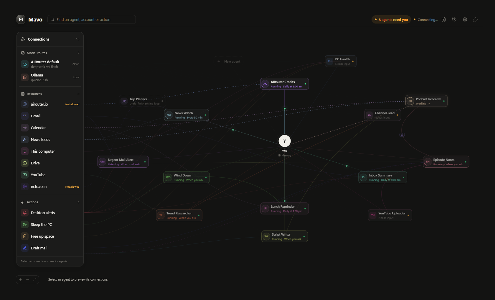

<div align="center">
  
  <h1>Mavo</h1>
  <p><strong>A personal AI workspace for agents that keep working beyond a single conversation.</strong></p>
  <p>Create specialist Crew, connect only what they need, and see their work happen.</p>
  <p>
    
    
    
    
  </p>
  <p>
    <a href="#quick-preview">Preview</a> ·
    <a href="#run-the-desktop-app">Get started</a> ·
    <a href="ARCHITECTURE.md">Architecture</a> ·
    <a href="SECURITY.md">Security</a> ·
    <a href="docs/roadmap.md">Roadmap</a>
  </p>
</div>

---

Mavo is a Windows desktop application for turning recurring responsibilities into persistent AI agents called **Crew**. Describe what you want, refine the proposed setup, grant specific access, and let a Crew run on its schedule or supported events.

The goal is not simply to answer messages. It is to make agent-based automation understandable: what an agent can read, which model it uses, when it runs, and what actually happened.

> **Project status:** active developer preview and portfolio showcase. The desktop application, backend, workers, and integrations are implemented, but this repository is not a ready-to-use hosted service. Production distribution still requires publisher infrastructure, provider authorization review, release testing, and installer signing.



*The running application with sample workspace data. This preview does not represent live account connections or completed user tasks.*

## What makes Mavo different

- **Responsibilities, not disposable prompts.** Multiple Crew instances can share a specialty while keeping separate instructions, permissions, schedules, checkpoints, and model budgets.
- **A workspace you can inspect.** A radial graph connects agents to a grouped Connections panel for model routes, resources, and actions. Persistent identity accents make relationships easier to follow.
- **Visible execution.** Actual model requests light up the provider and its link. Short-lived completion indicators remain visible even when a job finishes between screen refreshes.
- **Local-first persistence.** Conversations, Crew configuration, run history, and checkpoints live in SQLite on the device.
- **Models by use case.** Save named routes combining a provider, exact model, and credential. Crew can use Ollama, OpenAI, Anthropic Claude, OpenRouter, or AIRouter.
- **Permissions enforced in code.** Connecting an account does not grant every agent access. Reads, writes, resource grants, action restrictions, and execution budgets remain separate.

### From a request to a working Crew

1. **Describe** a responsibility in Chat or Create Crew.
2. **Clarify** the proposed setup and answer its questions.
3. **Review** the model route, resources, actions, and execution limits.
4. **Verify and add** the Crew, then inspect, run, pause, refine, or delete it.

Incomplete setups remain drafts. They are not silently published as active agents.

## Working capabilities

### Agents and automation

- Fifteen validated specialty templates, with independently configurable instances.
- Persistent Run/Stop workers, bounded work sessions, checkpoints, daily call limits, and restart recovery.
- Manual, interval, daily reminder, and supported Google resource-event triggers.
- Deterministic Schedule Crew reminders and permission-checked Computer Crew monitoring.
- Multiple persistent MAVO CORE conversations and description-first Crew planning.
- Desktop tray presence and an attached notification panel for reminders and agent updates.

Template availability does **not** imply that every specialty has a complete external integration.

### Resources and integrations

- **Computer:** CPU, memory, battery, and storage monitoring with explicit access.
- **Weather and location:** permission-controlled forecasts for the current location or another destination.
- **Google Workspace:** bounded Gmail, Calendar, and Tasks reads; separately authorized mail, event, and task actions; opt-in Drive metadata and Contacts reads.
- **GitHub:** selected repositories, issues, pull requests, and workflow/CI status, with separately controlled issue creation and comments.
- **Public feeds:** curated sources with caching and per-Crew permissions.
- **Local tools:** dedicated browser profiles, constrained Terminal operations, and scoped Windows controls.

Google and GitHub connections require publisher application setup and user consent. Gmail access is not implied by Google login; Drive metadata access is not document-content or editing access.

See [integration setup](docs/plugins/SETUP.md), [connecting accounts](docs/connecting-accounts.md), and [automation examples](docs/automation-examples.md).

## Architecture

Mavo uses a **modular monolith**, not a separate model process for every agent.

- **Desktop:** Tauri 2 manages the Windows shell and Python sidecar lifecycle.
- **Workspace:** React, TypeScript, Vite, Tailwind CSS, and Zustand.
- **Local backend:** FastAPI, Pydantic, SQLAlchemy 2, Alembic, and SQLite with WAL.
- **Execution:** bounded Crew workers, typed actions, resource adapters, and application-level permission checks.
- **Model routing:** one shared provider interface for local and user-configured cloud routes.
- **Coordinator:** a separate authenticated publisher gateway for normal chat and Crew planning.

```text
src/                     React workspace, graph, chat, and settings
src-tauri/               Windows shell and sidecar lifecycle
backend/src/mavo/        Domain logic, API, workers, adapters, and policies
backend/tests/           Backend regression and integration tests
publisher/               Coordinator deployment and configuration
scripts/                 PowerShell setup, development, build, and checks
docs/                    SDKs, integration guides, roadmap, and decisions
```

[Read the architecture](ARCHITECTURE.md) · [Explore the decisions](docs/decisions/) · [Resource SDK](docs/resource-sdk.md) · [Crew SDK](docs/crew-sdk.md)

## Quick preview

To explore the interface without configuring identity, providers, or the Python backend:

```powershell
git clone https://github.com/himanshu2005-tech/mavo.git
cd mavo
npm ci
npm run dev
```

Open:

```text
http://localhost:1420/preview.html?view=home&theme=dark&chat=0&tasks=0
```

This is an **interface-only preview using sample data**. It cannot execute Crew jobs or connect real accounts. Use the desktop setup below to run the application.

## Run the desktop app

### Prerequisites

- Windows 10 or 11 with WebView2.
- Python 3.12 or newer.
- Node.js 22 or newer.
- Rust stable using the MSVC toolchain.
- Visual Studio Build Tools with **Desktop development with C++** and a Windows SDK.
- Optional Ollama installation for local Crew inference.

### 1. Install dependencies

From the cloned repository in PowerShell:

```powershell
./scripts/setup.ps1
```

This installs locked frontend dependencies and creates the backend environment at `backend/.venv`.

### 2. Configure identity and the coordinator

The current application requires Firebase Google login. Normal chat and Crew setup use the publisher coordinator; installing Ollama alone does not replace that service.

Create local configuration files without overwriting existing settings:

```powershell
if (!(Test-Path .env)) {
    Copy-Item .env.example .env
}
if (!(Test-Path backend/firebase.json)) {
    Copy-Item backend/firebase.example.json backend/firebase.json
}
if (!(Test-Path publisher/.env)) {
    Copy-Item publisher/.env.example publisher/.env
}
```

Follow the guides for:

- [Firebase login](docs/firebase-setup.md): paste the Firebase public Web configuration into `backend/firebase.json` and configure Google sign-in.
- [Publisher coordinator](publisher/README.md): configure the Firebase project, coordinator model, data directory, and spending limits.
- [Google connectors](docs/google-setup.md): register the Desktop OAuth application if Google services are needed.
- [GitHub connection](docs/github-app-setup.md): register the publisher GitHub App if repository access is needed.

For local coordinator development, save its AIRouter key through the hidden prompt and start it in a separate terminal:

```powershell
./scripts/publisher.ps1 -SetKey
./scripts/publisher.ps1
```

The development gateway binds to `127.0.0.1:8741`. Keep `MAVO_CORE_GATEWAY_URL` pointed at that local address in the root `.env`.

Do not commit real `.env` files, Firebase deployment configuration, credentials, or application databases. Public desktop users should never be asked for the publisher's shared key.

### 3. Start Mavo

In another terminal:

```powershell
./scripts/dev.ps1
```

Sign in, add an agent model route in **Settings**, and describe your first Crew. Local Ollama routes need no cloud API key; cloud routes use the user's own provider credentials and credits.

If a previous development instance still owns the executable:

```powershell
./scripts/dev.ps1 -Restart
```

Restart interrupts active work. Closing the window can leave Mavo in the tray; use **Quit** to exit completely.

For a public installation, configure a deployed HTTPS coordinator and complete provider verification before distributing a build. A local developer gateway is not a public service.

## Security and privacy

- The backend binds to loopback and requires a per-launch bearer token.
- Sensitive endpoints are also protected by the application identity boundary.
- Provider credentials are stored with Windows DPAPI rather than in prompts or SQLite.
- OAuth uses browser authorization, PKCE, and validated callbacks.
- Resources and actions require explicit grants; saved action policies govern execution.
- External content is treated as untrusted input, not as authority to grant itself tools.
- Cloud fallback for local agents is **off by default** and requires an explicit route selection.
- Runtime activity signals contain metadata, not prompts, credentials, or model output.

**Local-first does not mean fully offline.** Firebase identity and the configured coordinator use network services. Connected resources and selected cloud models receive the data necessary for their authorized requests.

[Read the security policy and release considerations](SECURITY.md).

## Verification

Frontend tests, TypeScript checking, and a production frontend build:

```powershell
npm run check
```

Backend checks:

```powershell
./backend/.venv/Scripts/python.exe -m ruff check backend
./backend/.venv/Scripts/python.exe -m pytest backend/tests
```

The combined Windows check script also checks the Rust shell when its toolchain is available:

```powershell
./scripts/check.ps1
```

Isolated browser regressions cover graph interactions, provider-request indicators, persistent colors, permission states, reduced motion, and startup recovery. They use fixtures, not real user agents or paid provider requests. See [Development](DEVELOPMENT.md) for the commands.

## Build an installer

After configuring publisher identity and a public HTTPS coordinator:

```powershell
npm run tauri build
```

The build packages the Python backend before producing the Windows installer. Release guards reject incomplete publisher configuration. Installer signing and public distribution remain publisher responsibilities.

## Current boundaries

- Windows desktop is the supported target; other operating systems are future work.
- Scheduled work needs an awake computer and a running Mavo runtime.
- General-purpose Signals rules, dedicated goal orchestration, and hosted execution are not complete.
- Connected integrations are scoped capabilities, not full account synchronization.
- Browser automation uses a separate Mavo profile, not an existing Chrome session or exported passwords.
- Local tools remain constrained; unrestricted shell execution and arbitrary downloaded plugins are not provided.
- No payment collection or included cloud-model allowance is implemented.

[See the roadmap](docs/roadmap.md) for the longer-term direction.

## Contributing

Focused fixes, tests, accessibility improvements, and adapter work are welcome. Discuss substantial changes before implementing them, preserve the local security boundary, and do not add integrations that claim access they do not have.

See [CONTRIBUTING.md](CONTRIBUTING.md) for development and submission guidance.

## License

This repository is currently a portfolio showcase. A project-wide software license has not yet been selected.

---

<div align="center">
  Built by <a href="https://github.com/himanshu2005-tech">Himanshu</a> ·
  <a href="https://github.com/himanshu2005-tech/mavo/issues">Feedback and issues</a>
</div>
